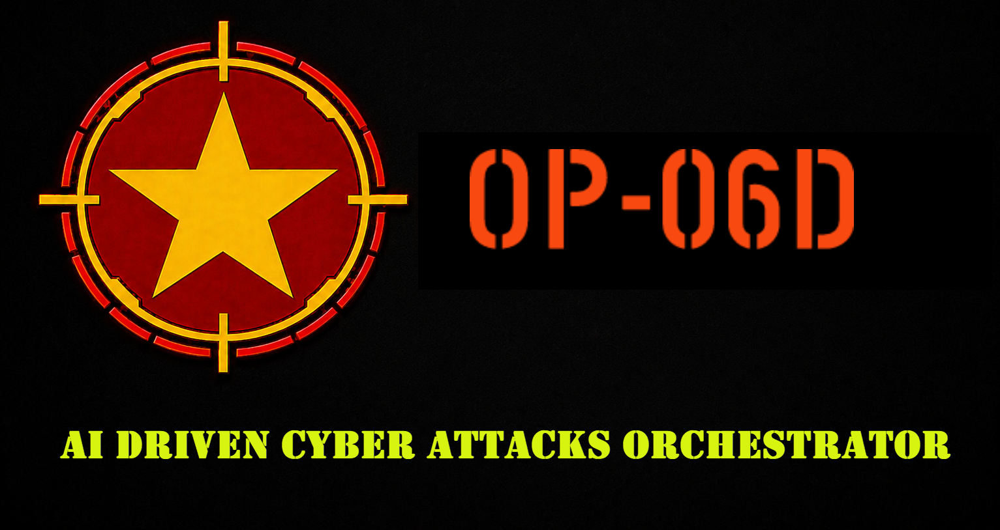

# OP-06D

An AI-driven security validation tool. A fixed recon plan or an LLM planner chooses
reconnaissance actions and drives real security tools against **authorized** targets, with every action forced through a
hard guardrail layer, and produces a client-grade report.

**OP-06D runs reconnaissance with nmap and nuclei, driven by a fixed or an LLM planner,
and is validated against the pinned tools in an isolated lab.** Authorized use only:
run it only against systems you own or hold signed authorization to test.

---

## ⚠️ Authorized use only

OP-06D runs reconnaissance tooling against networks and applications. Run it **only**
against systems you own or have **explicit, written authorization** to test.

- Every engagement requires a scope file naming the authorized targets and referencing
  the signed authorization. The tool refuses to act outside that scope.
- "I had a tool that let me" is not authorization. Unauthorized scanning is illegal in
  most jurisdictions, and a signed client scope does not override a cloud provider's or
  third party's own testing policies.
- You are responsible for operating within your authorization. The guardrails reduce the
  chance of a mistake; they do not transfer that responsibility.

To report a vulnerability in OP-06D itself, see [`SECURITY.md`](SECURITY.md).

---

## What it is

OP-06D's design principle is **own the orchestration, rent the attack content.** The
LLM is a *planner* that decides what to do next; the actual work is done by established,
community-maintained tools (nmap, nuclei). The parts that are uniquely OP-06D's — and
the parts that matter for safety — are the orchestration loop and the guardrail gate.

The guarantee the tool is built around: **the model proposes, the gate disposes.** Nothing
the LLM emits can widen scope, exceed the authorized rate, run outside the booked window,
or escape the audit trail. Enforcement lives in code, outside the model, and cannot be
altered by model output or by anything a scanned target says back.

## Prerequisites

OP-06D is a tool for security professionals. It assists a skilled operator; it doesn't
replace one, and it isn't a one-click scanner. To use it well you need:

### Knowledge

- Networking: TCP/IP, DNS, HTTP and TLS, CIDR notation.
- nmap and nuclei: what they do and how to read their output.
- Penetration-testing practice: scoping, rules of engagement, and written authorization
  from the system owner.
- Judgment: telling real findings from false positives, and knowing what a finding means
  for the client.
- The law on security testing where you work.

### Skills

- The command line (bash or PowerShell).
- Docker: images, volumes, networks and container capabilities.
- YAML, to write the engagement file.
- git and Python ([`uv`](https://github.com/astral-sh/uv)), to run the lab or work on
  OP-06D.

### For the optional LLM planner

- With the hosted model (Anthropic's API), scan results are sent to the model provider.
  Understand that, the API key and the cost before you use it on client work.
- With a local model: running a local model server (Ollama, llama.cpp or another
  OpenAI-compatible server), ideally on a machine with a GPU.

### Who it's not for

- Anyone expecting point-and-click results, a graphical interface, or a report that's
  ready to hand to a client without review.

## Architecture

```
Operator + scope file
        │
        ▼
Orchestrator (LLM loop)         plan → act → observe → repeat
        │
        ▼
   ┌───────────┐
   │   GATE    │   scope allowlist · rate cap · time window · audit · sanitize
   └───────────┘   every action passes through here; there is no other door
        │
        ▼
Tool layer (nmap, nuclei)       argv only, no shell; rate-limited; risk-classified
        │
        ▼
     Targets  (authorized scope only)

        └──────────────▶  Evidence store  ──▶  Report (client deliverable)
```

### The guardrail gate

Every action the planner proposes is checked by a single enforcement point before any
tool runs:

- **Scope allowlist** — the target must match the engagement's in-scope list (host and
  resolved IP) and match no out-of-scope entry. Deny wins; an empty allowlist denies
  everything (fail-closed); anything malformed or ambiguous is denied.
- **Rate cap** — actions are throttled to the engagement's `max_rps`, and each tool is
  also invoked with its own rate limit so the *actual* packet/request rate is bounded.
- **Time window** — actions outside the authorized window are refused.
- **Audit log** — every decision (allow and deny) is written to an append-only,
  hash-chained, per-engagement log. This is the liability record and the report evidence.
- **Output sanitization** — tool output (banners, HTTP bodies) is treated as hostile and
  wrapped as untrusted data before it re-enters the planning context, so a scanned target
  cannot prompt-inject the planner. The gate still blocks any bad action even if an
  injection slips through — sanitization is defense-in-depth, not the wall.

## Requirements

Docker, and nothing else: Docker Desktop on Windows and macOS, Docker Engine on Linux.
OP-06D, nmap, nuclei and the nuclei templates all ship in one signed image. Working on
OP-06D from source needs more; see [For contributors](#for-contributors).

## Install

The release image is `ghcr.io/mastodonsec/op06d`, version 0.0.2. Always use it by
digest, never by tag alone.

1. Pull it.

   PowerShell 7:

   ```powershell
   docker pull ghcr.io/mastodonsec/op06d@sha256:af5fde2cb0de230bef5e5dc4a688f3d1191653563e1824cb63c1d374ced308f6
   ```

   bash / zsh (Linux, Kali, macOS):

   ```bash
   docker pull ghcr.io/mastodonsec/op06d@sha256:af5fde2cb0de230bef5e5dc4a688f3d1191653563e1824cb63c1d374ced308f6
   ```

2. Verify its signature with [cosign](https://github.com/sigstore/cosign). The image is
   signed keyless by the repository's release workflow; a valid signature prints the
   verified claims as JSON and exits 0, anything else is a failed verification.

   PowerShell 7 (install cosign with `winget install --id Sigstore.Cosign --exact`):

   ```powershell
   cosign verify ghcr.io/mastodonsec/op06d@sha256:af5fde2cb0de230bef5e5dc4a688f3d1191653563e1824cb63c1d374ced308f6 `
     --certificate-identity "https://github.com/mastodonsec/OP-06D/.github/workflows/release.yml@refs/tags/v0.0.2" `
     --certificate-oidc-issuer https://token.actions.githubusercontent.com
   ```

   bash / zsh:

   ```bash
   cosign verify ghcr.io/mastodonsec/op06d@sha256:af5fde2cb0de230bef5e5dc4a688f3d1191653563e1824cb63c1d374ced308f6 \
     --certificate-identity "https://github.com/mastodonsec/OP-06D/.github/workflows/release.yml@refs/tags/v0.0.2" \
     --certificate-oidc-issuer https://token.actions.githubusercontent.com
   ```

   Without installing cosign, run it from its own image.

   PowerShell 7:

   ```powershell
   docker run --rm ghcr.io/sigstore/cosign/cosign:latest verify ghcr.io/mastodonsec/op06d@sha256:af5fde2cb0de230bef5e5dc4a688f3d1191653563e1824cb63c1d374ced308f6 `
     --certificate-identity "https://github.com/mastodonsec/OP-06D/.github/workflows/release.yml@refs/tags/v0.0.2" `
     --certificate-oidc-issuer https://token.actions.githubusercontent.com
   ```

   bash / zsh:

   ```bash
   docker run --rm ghcr.io/sigstore/cosign/cosign:latest verify ghcr.io/mastodonsec/op06d@sha256:af5fde2cb0de230bef5e5dc4a688f3d1191653563e1824cb63c1d374ced308f6 \
     --certificate-identity "https://github.com/mastodonsec/OP-06D/.github/workflows/release.yml@refs/tags/v0.0.2" \
     --certificate-oidc-issuer https://token.actions.githubusercontent.com
   ```

3. Check what it runs.

   PowerShell 7:

   ```powershell
   docker run --rm ghcr.io/mastodonsec/op06d@sha256:af5fde2cb0de230bef5e5dc4a688f3d1191653563e1824cb63c1d374ced308f6 version
   ```

   bash / zsh:

   ```bash
   docker run --rm ghcr.io/mastodonsec/op06d@sha256:af5fde2cb0de230bef5e5dc4a688f3d1191653563e1824cb63c1d374ced308f6 version
   ```

   **Expected output:**

   ```
   op06d 0.0.2
   nmap 7.93
   nuclei 3.11.1
   nuclei-templates v10.5.1 (/opt/nuclei-templates, read-only)
   base_image debian:bookworm-slim@sha256:734a72b3d6142a71993b4bc580ca01d8ca687f77a2c422d96a961d3376b179bc
   nmap_package 7.93+dfsg1-1
   nmap_raw /usr/lib/op06d/nmap-raw
   ```

[docs/container.md](docs/container.md) covers the rest: capabilities, mounts, the
antivirus note, and full verification including the SBOM and build provenance.

## What's in the box

- **Included.** The image ships the tools and templates OP-06D uses, at the versions
  validated in the lab: nmap 7.93, nuclei v3.11.1 and nuclei-templates v10.5.1. You
  install only Docker.
- **Nothing is downloaded at run time.** No tools, updates or templates are fetched
  during an engagement: nuclei's update check is off and the template directory is
  read-only. What runs on a client network is exactly what was validated and signed,
  the report states which versions ran, and a compromised upstream can't reach a
  client network through OP-06D.
- **New tools and template updates arrive as new image releases.**
- **The planner chooses among the included tools.** It never installs anything.
- **From source,** contributors bring their own nmap and nuclei; only the versions
  above are supported.

## Where to run OP-06D

A scan has to start from the right place, so where you run OP-06D depends on what
you're testing. It's one signed image, run the same way wherever the scan needs to
start from.

| You're testing | Run OP-06D on | Why |
|---|---|---|
| The lab, or a target reachable from your machine | Your Linux or Kali machine (`docker run`) | Simplest; host networking gives nmap raw sockets |
| An external attack surface | A clean Linux VM in the cloud | A fixed source IP the client can name in the rules of engagement and recognise in their logs; one VM per client keeps evidence separate |
| An internal network | A Linux host inside the client's network | Internal targets are only reachable from inside |
| A network you reach over the client's VPN (also TryHackMe and HTB) | Your own machine with the VPN connected | The VPN is your vantage point; on Windows and macOS nmap is limited to connect scans, reported in Limitations |

Windows and macOS (Docker Desktop) work for the lab and for connect-scan recon; raw
scans need Linux. OP-06D ships as a container rather than an installer because the
image carries the exact tool versions validated in the lab, so every platform runs the
same thing.

Before scanning from a cloud VM, check your cloud provider's acceptable-use policy on
outbound scanning.

## Usage

OP-06D is driven by a single declarative **engagement file** and one command. The
engagement file *is* the authorization boundary — it names the authorized targets, the
rate cap, and the window, and the gate enforces exactly what it says.

Run it from a directory holding your `engagement.yaml`. The engagement file is mounted
read-only and a local `out` directory is mounted at `/out`. Create `out` before the run,
owned by your user; if Docker creates it, it is owned by root and the run is refused.
To try the commands, save [`examples/engagement.yaml`](examples/engagement.yaml) as
`engagement.yaml`.

**Linux (engagements).** Host networking and two capabilities give nmap raw sockets,
as your own user. Never use `--privileged`.

```bash
mkdir -p out
docker run --rm \
  --network host \
  --cap-add NET_RAW --cap-add NET_ADMIN \
  --user "$(id -u):$(id -g)" \
  -v "$PWD/engagement.yaml:/work/engagement.yaml:ro" \
  -v "$PWD/out:/out" \
  ghcr.io/mastodonsec/op06d@sha256:af5fde2cb0de230bef5e5dc4a688f3d1191653563e1824cb63c1d374ced308f6 \
  run --engagement engagement.yaml --out /out
```

**Windows (PowerShell 7) and macOS (zsh).** Docker Desktop can't send raw packets to
your network: run without host networking and without capabilities. nmap then runs as a
TCP connect scan, and the report's Limitations say so.

PowerShell 7:

```powershell
New-Item -ItemType Directory -Force out | Out-Null
docker run --rm `
  -v "${PWD}/engagement.yaml:/work/engagement.yaml:ro" `
  -v "${PWD}/out:/out" `
  ghcr.io/mastodonsec/op06d@sha256:af5fde2cb0de230bef5e5dc4a688f3d1191653563e1824cb63c1d374ced308f6 `
  run --engagement engagement.yaml --out /out
```

macOS (zsh):

```zsh
mkdir -p out
docker run --rm \
  -v "$PWD/engagement.yaml:/work/engagement.yaml:ro" \
  -v "$PWD/out:/out" \
  ghcr.io/mastodonsec/op06d@sha256:af5fde2cb0de230bef5e5dc4a688f3d1191653563e1824cb63c1d374ced308f6 \
  run --engagement engagement.yaml --out /out
```

`--out` (required) is the directory for the HTML report, the evidence store and the
audit log; in the container it must be the mounted `/out`, so the files land in your
local `out` directory. The default **fixed planner** runs, per in-scope host or IP, an
nmap service scan and a nuclei default-tag scan, and per in-scope CIDR an nmap service
scan; nuclei uses the image's pinned template set. The example's window (2026-11-10,
02:00 to 06:00 UTC) has passed, so this command scans nothing: every action is refused
at the gate and the report records that. For a real engagement, write your own
engagement file.

```
run_id: cb61ba8f-5d77-4809-8ebb-12660d989f94
actions: executed=0 denied=3 declined=0 tool_errors=0
findings: none
report (html): /out/acme-saas-external-2026-11-cb61ba8f-5d77-4809-8ebb-12660d989f94.html
evidence store: /out/evidence.db
audit log:      /out/audit/acme-saas-external-2026-11.audit.jsonl
```

To let a model propose the actions instead (through the same gate), add
`--planner llm --llm-provider local` (or `anthropic`); see
[docs/llm-planner.md](docs/llm-planner.md). In the container, pass the Anthropic API
key with `--env-file`, and reach a local model as described in
[docs/container.md](docs/container.md).

### Engagement file

```yaml
engagement: acme-saas-external-2026-11
authorization:
  client: "Acme Corp"
  signed_scope_ref: "SOW-2026-114"     # your authorization paper trail
  authorized_by: "jane.doe@acme.com"
  window: ["2026-11-10T02:00Z", "2026-11-10T06:00Z"]   # off-hours only
scope:
  in_scope:
    - app.acme.com
    - 203.0.113.0/28
  out_of_scope:
    - "*.stripe.com"      # third-party SaaS they don't own
    - billing.acme.com    # explicitly excluded by the client
intensity:
  max_rps: 20
  destructive: false      # destructive actions require this to be true
objective: "External attack surface recon"
planner:                  # optional; without it only the local LLM provider may plan
  allowed_providers: [local]   # local and/or anthropic (hosted: findings leave the host)
```

The `planner:` block is not in `examples/engagement.yaml`; `--planner fixed` ignores
it. All fields are documented in [docs/engagement-parser.md](docs/engagement-parser.md).

Scope rules worth knowing:

- Plain entries are **exact**: `acme.com` does **not** cover subdomains, and `*.acme.com`
  does **not** cover the apex `acme.com`. List what you mean.
- An explicit `out_of_scope` entry always wins over any `in_scope` match.

## Limitations

- Before a live engagement you need a signed, authorized scope, referenced in the
  engagement file.
- Not supported: exploitation, breach-and-attack simulation, cloud posture auditing,
  authenticated app testing, and a web UI.

## Demo

[`examples/demo_gate.py`](examples/demo_gate.py) shows the scope check making
allow/deny decisions **without running any scan or touching the network** (DNS is
faked). It loads `examples/engagement.yaml`, widens its scope with `*.acme.com` and an
excluded `203.0.113.8/29` so the deny-wins cases can be shown, runs eight targets
through the scope check (`op06d.scope.check_scope`), records every decision in a
hash-chained audit log in a temporary directory, and verifies that log. The
window and rate checks of the full gate are not part of this demo. It runs from a
source checkout (see [For contributors](#for-contributors)).

PowerShell 7:

```powershell
uv run python examples/demo_gate.py
```

bash / zsh:

```bash
uv run python examples/demo_gate.py
```

Real output (the timestamp and hashes in the last line differ on every run):

```
[ok ] ALLOW '203.0.113.5'        allow: IP in in-scope 203.0.113.0/28
[ok ] DENY  '203.0.113.9'        deny: IP is in out-of-scope 203.0.113.8/29
[ok ] ALLOW 'app.acme.com'       allow: host in scope
[ok ] DENY  'billing.acme.com'   deny: host matches out-of-scope entry 'billing.acme.com'
[ok ] DENY  'www.acme.com'       deny: resolved 203.0.113.9 is in out-of-scope 203.0.113.8/29
[ok ] DENY  'evil.example.net'   deny: host matches no in-scope host entry
[ok ] DENY  '127.1'              deny: malformed target (ambiguous numeric hostname '127.1')
[ok ] DENY  None                 deny: malformed target (target has unexpected type NoneType)

Audit log verified: 9 entries -> acme-saas-external-2026-11.audit.jsonl
Last entry as stored:
  {"v":1,"seq":9,"ts":"2026-11-19T00:06:33.424Z","engagement":"acme-saas-external-2026-11","event":"gate_decision","target":"'<NoneType>'","tool":"demo","parameters":{"note":"manual test"},"allowed":false,"reason":"deny: malformed target (target has unexpected type NoneType)","prev_hash":"4be40b81b4f69f86cd37b1b4aa66f543f4fc8f02cccf0780022eae957fdb5bcd","hash":"522d72b074ffff29c491b5d2912955ac649b72faacefdae0b2ffdf1c33bcbf19"}
```

## For contributors

Working on OP-06D from source needs Python 3.11+, [`uv`](https://github.com/astral-sh/uv)
and git, plus `nmap` and `nuclei` on `PATH` to run real scans, at the validated
versions: nmap 7.93, nuclei v3.11.1 and nuclei-templates v10.5.1. The unit tests and
the gate demo don't need the tools; they mock or avoid them.

PowerShell 7:

```powershell
git clone https://github.com/mastodonsec/OP-06D.git
cd OP-06D
uv sync
```

bash / zsh:

```bash
git clone https://github.com/mastodonsec/OP-06D.git
cd OP-06D
uv sync
```

Run an engagement from source. Without the image, nuclei runs only when
`--template-dir` points at a pinned nuclei template directory, and is otherwise refused
as an unknown tool; `--templates-pin`, `--nmap-version` and `--nuclei-version` record
the versions in the report.

PowerShell 7:

```powershell
uv run op06d run --engagement examples/engagement.yaml --out out/
```

bash / zsh:

```bash
uv run op06d run --engagement examples/engagement.yaml --out out/
```

Run the tests:

PowerShell 7:

```powershell
uv run --extra dev pytest
```

bash / zsh:

```bash
uv run --extra dev pytest
```

On Windows, pointing `--basetemp` at a directory outside the repository (for example
`--basetemp Z:\Temp\op06d-pytest`) avoids file locks on pytest's temporary files.

The unit suite mocks all subprocesses — **no test starts a real scanner or touches a real
host.** Real-tool behavior is validated separately in the isolated lab
([`lab/RUNBOOK.md`](lab/RUNBOOK.md)). The lab-gated integration tests are deselected
by default (they need `-m lab`, `OP06D_LAB=1` and the lab), and the live-model test
is skipped unless `OP06D_LIVE_MODEL=1`.

How the project is run, the sign-off it needs and what to read first:
[`CONTRIBUTING.md`](CONTRIBUTING.md). How the image is released:
[`docs/release.md`](docs/release.md).

## The lab

The lab is optional: OP-06D runs against any authorized target without it. It's a sealed
Docker network with deliberately vulnerable targets (OWASP Juice Shop, DVWA and a small
nginx redirect service) and a scanner built from the OP-06D image itself (the
`Dockerfile`'s `lab` stage: the same image plus test tools), so it runs the same pinned
nmap, nuclei and templates. Nothing in the lab can reach the internet, your network or
your host, and an isolation check proves that before anything scans. The one exception
is opt-in: for LLM planner runs, a model relay opens a single path, to Anthropic's API
or to Ollama on your host, and has its own isolation check.

It has two jobs:

1. **A practice range:** learn how OP-06D works and what its output, report and audit
   log look like, against targets you're allowed to break.
2. **The project's reference environment:** changes are validated here against known,
   planted vulnerabilities ([`lab/PLANTED_VULNS.md`](lab/PLANTED_VULNS.md)), so results
   are repeatable. It's also where planner models are compared.

Run it once after installing, before your first authorized engagement, to confirm your
setup works and to see real output. Start with the quick start,
[`lab/README.md`](lab/README.md). [`lab/RUNBOOK.md`](lab/RUNBOOK.md) is the maintainer's
validation reference.

## Project layout

```
src/op06d/
  __init__.py            package marker
  approval.py            interactive operator approval prompt (default deny, timeout)
  audit.py               append-only, hash-chained per-engagement audit log
  cli.py                 the op06d command: run (engagement to report) and report (re-render a stored run)
  engagement.py          engagement-file schema and loader (the authorization boundary)
  evidence.py            SQLite evidence store: runs, actions and findings, for the report
  gate.py                the single enforcement point (window · scope · rate), one audit entry per decision
  limits.py              time-window and rate-cap primitives used by the gate
  llm.py                 LLM planner adapters: hosted Anthropic, local Ollama / llama.cpp / OpenAI-compatible
  nmap_tool.py           nmap wrapper (argv only, rate-limited, risk-classified, sized host timeouts)
  normalize.py           maps nmap and nuclei output to one findings schema
  nuclei_method_audit.py finds nuclei templates that declare an HTTP write method
  nuclei_tool.py         nuclei wrapper (curated templates, no out-of-band, no redirects, write-method backstop)
  nuclei_write_method_exclusions.json  bundled write-method template ids for the pinned template set
  orchestrator.py        the plan-act-observe loop and its run limits
  redaction.py           secret scrubbing for the audit log, evidence store and CLI errors
  report.py              client report model and Markdown rendering
  report_render.py       self-contained HTML report, optional PDF
  resolve.py             resolve-once DNS pinning (the only place DNS lookups happen)
  sanitize.py            tool-output sanitization against prompt injection
  scope.py               scope decision logic (deny wins, fail closed)
  toolchain.py           the image's baked toolchain (tool versions and template directory)
  tools.py               GatedToolbox (tools reachable only through the gate) and default_tools
examples/
  demo_gate.py           the scope-check demo above
  engagement.yaml        example engagement file
scripts/
  check_image.py         checks a built image: non-root, baked pins, no secrets, capabilities on nmap-raw only
  check_repo_hygiene.py  repository hygiene guard (ticket keys, history and status wording in Markdown)
  generate_nuclei_write_method_exclusions.py   regenerates the write-method list on a template re-pin
  update_docker_requirements.py  regenerates the hash-pinned docker/ requirements from uv.lock
Dockerfile               the release image (product stage) and the lab scanner (lab stage)
docker/                  hash-pinned image requirements, generated from uv.lock
.github/
  workflows/             ci, release (build, sign, attest the image), close-external-prs
  dependabot.yml         dependency update configuration
docs/                    design notes per component, plus:
  container.md           running the image: capabilities, mounts, verification
  release.md             releasing the image
tests/                   unit suite; tests/integration/ holds the lab-gated tests
lab/                     isolated Docker lab for live validation:
                         - README.md: the lab quick start
                         - RUNBOOK.md: the maintainer's validation reference
                         - targets: OWASP Juice Shop and DVWA, plus an nginx redirector
                         - scanner: the image's `lab` stage (same image plus test tools)
                         - isolation gate: check_isolation.py (Windows, Linux, macOS)
                         - validation_harness.py: one-command run of the RUNBOOK checks
                         - model relay overlay for --planner llm runs (model_relay.py)
                         - planner model benchmark (benchmark.py)
                         - PLANTED_VULNS.md: the frozen baseline; captures/: frozen evidence
SECURITY.md              how to report a vulnerability in OP-06D
CONTRIBUTING.md          how the project is run, DCO sign-off
```

## License

OP-06D is licensed under the **GNU Affero General Public License v3.0 or later
(AGPL-3.0-or-later)** — see [`LICENSE`](LICENSE). In short: you are free to use,
study, modify, and redistribute it, but any modified version you distribute **or
run as a network service** must be made available under the same license. If you
run a modified OP-06D as a service for others, you must offer them its source.

The image also bundles nmap (Nmap Public Source License), nuclei and nuclei-templates
(MIT), under their own licences.

Copyright (c) 2026 Thomas Pavan / Mastodon Security.

For how the project is run, see [`CONTRIBUTING.md`](CONTRIBUTING.md). Read
[`NOTICE`](NOTICE) before running the tool — it is for authorized testing only.
